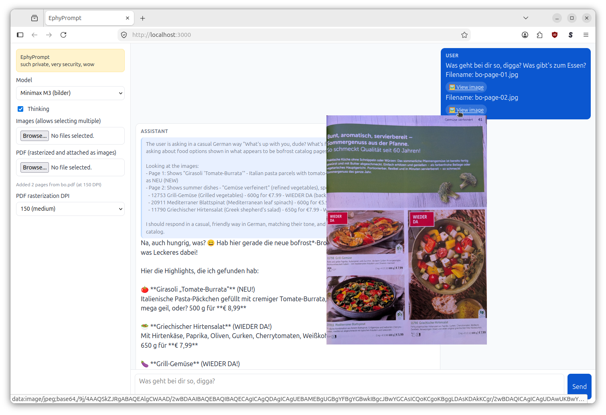

# EphyPrompt



EphyPrompt is a simple LLM chat UI which runs completely locally and calls out to your LLM provider.

The name EphyPrompt is an abbreviation for Ephemeral Prompting.

It assumes the user brings their own LLM inference provider and has a quick and private chat with it.

With a vision model, it can handle images and whole PDFs (via brute-force, rendering each page as an image).

## CUJs

1. As a user, I can hard-code my OpenAI-compatible baseURL, (e.g., `TENSORX_URL = "https://api.tensorx.ai/v1/chat/completions"`), and pass my API key (e.g., `OPENAI_API_KEY=sk-XXX`) and start chatting. Currently hard-coded for tensorx.ai, Also tested (once) on OpenRouter.
2. As a user, I can chat with the LLM API in the web UI via the streaming chat interface.
3. As a user, I can attach images, which are sent to the LLM API. The images and files are uploaded from my computer and sent directly to the LLM API as part of the prompt; they never leave your machine except to your LLM API in the current chat session.
4. As a user, I can attach even weird PDFs or scans, which get sent to the LLM as _images_.
5. As a user, I can use EphyPrompt completely locally. No external resources are loaded (no CDNs, fonts, or telemetry); the only network access is to the LLM API.
6. As a user, my complete chat history and uploads are preserved for the current chat session; but all is cleared once I reload the page.

## Architecture

* A single (HTML, CSS, Javascript) website serves as the complete user interface.
* A tiny python webserver acts as proxy to send requests to the LLM provider. The API key is only exposed to this webserver.

## Properties

* If the external LLM provider has good privacy and does not retain any data, EphyPrompt is 100% private and retains 0 data.
* EphyPrompt is one single-page website. And a tiny local proxy due to CORS restrictions, for PDF rasterization, and to set a Content Security Policy.
* EphyPrompt relies on a minimal set of external modules (only `pymupdf`) and does not include external data. This makes it extremely easy to audit.
* EphyPrompt can be easily run on common client operating systems.
* Data entered into EphyPrompt is only sent to your LLM API; it otherwise never leaves EphyPrompt.
* Metadata is only logged locally in the local proxy to STDOUT and to the JavaScript console. Never explicitly persisted or stored.

## Known Issues

* Never share your API key.
* Since EphyPrompt shall run without external dependencies, we cannot `npm install openai` or `import OpenAI from "openai";`.
* Due to above, EphyPrompt is not using the official OpenAI JavaScript module, but only uses raw `fetch`.
* Unfortunately, the tensorX API doesn't accept requests from the browser directly. Okay, this is actually a very good choice, since it prevents insecure setups which expose the API key to the client browser (which would be a feature in EphyPrompt, but is normally a very bad design). So we need a local proxy to resend the request to the API.

## Usage

```sh
podman build -t ephyprompt .
```

```sh
podman run --rm -it --network host -e OPENAI_API_KEY=XXX ephyprompt
```

The `--network host` is deliberate, since native EphyPrompt binds only to localhost.

Also runs on Windows or any other OS with python3 and `pymupdf` installed.

## Development

```sh
python3 -m venv .venv
source ./.venv/bin/activate
pip install --upgrade pymupdf
```
